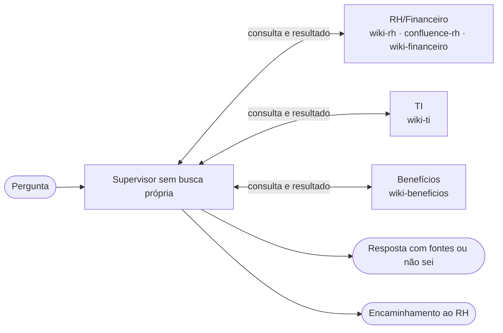

# Nota de arquitetura · Encontro 4

**ValidAI · Aurora · 04/11/2026**

**Integrantes:** Jhonatan Pereira; Pedro Henrique Panegossi; Gabriela Chaves; Ana Carolina Wichinieski.

## 1. O padrão escolhido

**Supervisor + 3 especialistas**, em protótipo com revisão humana. Consultas delegadas, sem busca própria ou fallback global; 8 passos por loop. Ausência de suporte: `nao_sei`; elegibilidade: RH. Roteador/`se_incerto` não se aplicam ao supervisor. Os espaços estão no diagrama.

## 2. O diagrama



## 3. O placar

Comparação resumida; [sete configurações completas](evidencias/placar.md). Variantes do roteador mudam uma opção em relação a LLM/3/original/seguir.

| arquitetura | acertos | rota certa | chamadas/caso | tokens/caso | custo total (US$) | custo/acerto (US$) | seg/caso |
|---|---|---|---|---|---|---|---|
| agente único (Aula 3) | 16/19 | 17/17 | 2.6 | 3007 | 0.0655 | 0.00409 | 2.7 |
| roteador llm · 3 esp · original · incerto→segue | 16/19 | 14/17 | 3.1 | 2588 | 0.0599 | 0.00375 | 3.2 |
| roteador regra · 3 esp · original · incerto→segue | 16/19 | 14/17 | 2.0 | 2279 | 0.0506 | 0.00316 | 2.1 |
| supervisor · 3 esp | 17/19 | 15/17 | 3.9 | 3370 | 0.079 | 0.00465 | 4.2 |

**Replay:** `gpt-4o-mini`, 12/10/2026; 405 chamadas reproduzidas, nenhuma ao vivo/ausente. Preços do arquivo: US$ 1 entrada/US$ 5 saída por milhão; tempos da gravação, não SLA. Não comprova estabilidade. Rota mede cobertura de espaços, não autorização; dois casos não avaliam rota.

## 4. A divisão se paga?

**Sim, pelos limites por fonte e consultas a várias áreas:** supervisor/3 fez 17/19 contra 16/19 do único, com custo/acerto 13,5% maior. Ganhou S1/S2, perdeu P1; R1 já era correto no único, mas os roteadores perdem TI. Especialistas têm filtros no código; o supervisor recebe resultados delegados, registrados no trace. Regra custa menos, mas erra T2/R1/R2; quatro especialistas/resumo não melhoraram acertos, e fallback global caiu para 15/19 e remove a parede. **Reversão proposta:** trocar por roteador com ≥17/19, T2/R1/R2 corretos, filtros preservados e menor custo/acerto; ainda não demonstrado.

## 5. Um caso, aberto

**S1 — previdência privada. Causa:** ausência no corpus e encerramento; único insiste até o limite, supervisor reconhece falta de informação:

```text
[agente único] parou: passou de 8 passos
[especialista beneficios] encerrou: nao_sei · fontes []
[supervisor] encerrou: nao_sei · fontes []
```

**Pendências:** P1 retorna `nao_sei`; R2 vai a Benefícios, sem acesso à política de internet em RH. Corrigir antes de produção; autorização por usuário não foi avaliada. [Traces](evidencias/traces.txt); [evidências](evidencias/experimentos.json).

**Reprodução:** na raiz, com `.venv`: `python -X utf8 encontro-04/experimento_equipe.py`.
